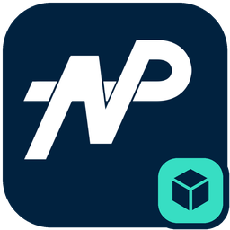
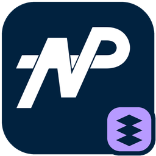

# NewPageMergeMDL v1.2.36

<p>


</p>

[English](README.en.md) | 简体中文

基于 [PulseModel](https://github.com/ToppiOfficial/PulseModel) 的 Source 模型工具，整合 StudioMDL-CE、StudioMDL++、NekoMDL 和 StudioMDL 2013 的兼容功能，提供编译器、反编译器及四个辅助工具。

**[下载与发布说明](https://github.com/NPCodex/newpage-merge-mdl/releases) · [安装指南](INSTALL.md) · [功能清单](FEATURE_MATRIX.md) · [兼容说明](COMPATIBILITY.md)**

## 下载与安装

从 Releases 下载对应平台的完整安装包，解压到新目录并保持目录结构。每个版本实际提供的平台、构建状态与发布说明均以该版本 Release 为准；GitHub 自动生成的 **Source code** 不是安装包。

- 主程序：`NewPageMergeMDL.exe`；反编译器：`NewPageMergeMDL-Decompiler.exe`。
- `subtools/` 包含下文的四个辅助工具。Windows 完整包另含 C4D 桥接程序，VRML 使用独立转换器。
- 更新时使用整套新文件，避免混用不同版本的主程序、辅助工具与依赖。
- 普通模型编译无需 Python；`tools/` 中的 Python 准备脚本需要 Python 3。来源和校验信息见包内 `upstream-manifest.json`、`SHA256SUMS.txt`。

以下命令从解压目录的 PowerShell 运行，请替换示例路径并先创建输出目录。Linux 使用对应无 `.exe` 的程序和 `./` 路径；C4D 桥接仅支持 Windows。

## 编译前必读

**`-game` 必须指向目标游戏/模组中包含正确 `gameinfo.txt` 的目录**，尤其是 CSGO 和 MCV。它不是 Steam 根目录、`bin` 目录或 `gameinfo.txt` 文件本身，也不能借用其他游戏的配置。编译器据此选择目标布局、资源挂载与默认参数。

```powershell
.\NewPageMergeMDL.exe "D:/models/model.qc" -game "D:/Games/csgo legacy/csgo" -OutDir "D:/build/model"
.\NewPageMergeMDL-Decompiler.exe "D:/models/model.mdl" -outdir "D:/build/decompiled" -smdanimation
```

反编译结果写入输出目录下的 `decompiled <版本>/<模型名>/`；`-smdanimation` 将动画导出为 SMD，默认使用 DMX。请保留输入模型所需的 VVD/VTX/ANI 文件；`-nomesh` / `-noanimation` 可明确跳过相应部分。

- `-OutDir` 指定输出根目录，`$modelname` 决定模型路径；它不替代 `-game`。编译支持 `.qc` / `.pulseqc`，资源和 VMT/VTF 材质需自行准备。
- 参数优先级：`gameinfo < cfg/commandline.cfg < 显式命令行`；`-nodefaultargs` 禁用前两者。CE/Neko 差异通过显式兼容选项选择。
- 先在隔离目录输出并在目标游戏验证，再整套替换匹配的 MDL/VVD/VTX/PHY/ANI。不要混用旧伴随文件；中断后保留 `.npmdl-*` 恢复文件，按诊断处理。
- 反编译器与 AG2 使用持久恢复日志，并拒绝同目标并发运行；中断后保留 `.newpage-output-transactions`、`.newpage-output-locks` 及备份，重跑同一任务恢复。若报告外部修改冲突，先检查原因。VMD/L4D 的批次回滚仅覆盖普通错误；详见 [安装指南](INSTALL.md)。
- 最终骨预算、每顶点权重和其他格式/引擎限制仍有效。CSGO/MCV 扩展 VTX 依赖正确 AppID，FE 布料限 CSGO；SubD 建议使用默认离线烘焙，已测 CSGO legacy 原生 SubD 路径会崩溃。

## 主要功能

- SMD、DMX、FBX、glTF/GLB/VRM 及 Assimp 场景导入；实际构建支持的格式可用 `NewPageMergeMDL.exe -importformats` 查看。
- 骨骼动画、flex/形态键、LOD、材质与皮肤组、程序骨和碰撞；支持 CE/Neko 兼容策略及 ++ 动画扩展。
- CSGO DMX rig 烘焙、FE 布料和离线 SubD；具体输入条件见专项指南。
- MDL 反编译，以及网格状态、VRM 准备工具。网格状态和 VRM 运行效果需配套 GMod Lua 模块，不能仅靠 MDL 在所有游戏中生效。

详细功能与限制集中在下方文档；参考编译器的有限对照不代表任意模型或所有游戏完全等价。

## 四个 subtools 的使用方式

### vmd2valvebiped：MMD 动作转 ValveBiped 动画

输入 VMD 动作与提供骨架比例的 MDL，输出 DMX 动画。目标 MDL 必须具有左右腿 IK 链；`-pmx` 可指定原 MMD 模型，以其静止骨架替代内置骨架。

```powershell
.\subtools\vmd2valvebiped.exe -vmd "D:/motions/dance.vmd" -mdl "D:/models/character.mdl" -o "D:/build/dance.dmx"
```

输出为指定的 `dance.dmx`，随后在自己的 QC 中引用并编译。添加 `-dmxmodel 22` 可输出支持的表情通道。可重复 `-vmd` 批量处理，此时不要使用只针对单个输出的 `-o`；默认写到各 VMD 旁边。有相机键时另写 `<输出名>_camera.smd`，加 `-camerafov dmx` 可额外输出相机/FOV DMX。不带参数运行可查看完整帮助。

添加 `-compile "my_animation" -game "D:/Games/MyMod"` 可直接调用随包 `NewPageMergeMDL`；`-game` 仍须使用真实目标游戏目录。转换源与编译产物全部成功后一起发布，普通失败保留原输出。

### l4d_animswap：L4D2 幸存者动画序列适配

`-rig` 表示模型使用谁的骨架，`-replace` 表示要替换谁。`-vanilla` 目录中需放置所需原版 `survivor_*.mdl` 及其引用的 `anim_*.mdl`、`gestures_*.mdl`。

```powershell
.\subtools\l4d_animswap.exe -vanilla "D:/L4D2/extracted-survivors" -rig zoey -replace rochelle -o "D:/build/zoey_to_rochelle.qci"
```

将生成的 QCI 通过 `$include` 接入自己的 QC，再编译模型。`-skip` 默认跳过由模型自身定义的前两个序列槽；检查生成文件的注释，并补齐 `REPLACE ME` 项或按需选择 `-ref` / `-usenoanimation`。

- 支持角色：`bill francis louis zoey coach nick ellis rochelle`。
- `-retarget` 额外导出部分场景动作到 QCI 旁的 `anims/`，供后续编译使用；使用外部动画块的原版模型还需在 `-vanilla` 目录准备对应 `.ani` 文件。
- 批量生成可用 `-vanilla "D:/L4D2/extracted-survivors" -all -outdir "D:/build/swaps"`。不带参数运行查看完整帮助。

### meshtool：网格简化与凸分解接口

供编辑器或脚本调用：`simplify` 简化三角网格，`decompose` 进行凸分解。输入与输出都是对应的**二进制请求/响应文件**，不能直接传入 MDL、SMD、FBX 或 OBJ。普通模型作者通常无需单独调用。

```powershell
.\subtools\meshtool.exe simplify "D:/requests/simplify.bin" "D:/build/simplify-result.bin"
.\subtools\meshtool.exe decompose "D:/requests/decompose.bin" "D:/build/decompose-result.bin"
```

调用方先生成请求，执行命令并检查退出码（成功为 `0`），再读取响应。两种协议不同：简化返回索引及误差，凸分解返回各凸块点云，调用方需重新构造凸包。字段布局见 [simplify 实现](subtools/meshtool/mesh_simplify.cpp) 与 [decompose 实现](subtools/meshtool/convex_decompose.cpp)。

### ag2proportions：CS2 AnimGraph2 比例适配（实验性）

为 CS2 生成骨架比例动画与 worldmodel/uimodel 动画图。需要安装 CS2，并准备模型使用的骨架 DMX；编译资源还需要 **CS2 Workshop Tools**。VMDL 必须位于 `<CS2>/content/csgo_addons/<addon>/` 内。先将模型项目复制到独立测试 addon，保留 DMX 等资源的相对路径。

```powershell
$cs2 = "D:/SteamLibrary/steamapps/common/Counter-Strike Global Offensive"
.\subtools\ag2proportions.exe "$cs2/content/csgo_addons/my_model_test/models/agent.vmdl" --debug
```

直接传入 VMDL 会修改该副本，并保留首次 `.vmdl.bak`。生成源资源位于 VMDL 旁的同名目录，编译资源写入对应的 `game/csgo_addons/<addon>/`。查看生成的 `debug/MODEL_SETUP.txt`，再在 ModelDoc 编译完整模型并验证动作。

如需保持 VMDL 原样，在测试 addon 根目录保存 `job.kv3`：

```text
<!-- kv3 encoding:text:version{e21c7f3c-8a33-41c5-9977-a76d3a32aa0d} format:generic:version{7412167c-06e9-4698-aff2-e63eb59037e7} -->
{
    vmdl = "models/agent.vmdl"
    write_model = false
}
```

```powershell
.\subtools\ag2proportions.exe "$cs2/content/csgo_addons/my_model_test/job.kv3" --generate-only --debug
```

Job 中的路径相对 job 文件；可选 `model_dmx` 指定骨架、`proportions` 指定保持姿态的 DMX。`--generate-only` 仅跳过资源编译，仍需 CS2 数据；是否修改 VMDL 由 `write_model` 决定。`--help` 查看完整参数。

此工具不用于 Source1 MDL 手臂修复。比例 clip 主要调整平移，不重做骨轴或蒙皮；资源编译验证不代表完整人物或游戏动作已认证。暂存、进程中断恢复和同目标并发保护的范围见 [安装指南](INSTALL.md)，具体实测见 [验证记录](VALIDATION.md)。

## 详细文档

| 内容 | 文档 |
| --- | --- |
| 功能覆盖与兼容参数 | [功能清单](FEATURE_MATRIX.md) · [兼容说明](COMPATIBILITY.md) |
| 已验证范围与参考证据 | [验证记录](VALIDATION.md) · [五编译器固定范围](FIVE_COMPILER_COMPLETION.md) · [二进制调查](BINARY_ANALYSIS.md) |
| CSGO 专项 | [DMX 输入与 rig](CSGO_DMX_INPUTS.md) · [布料](CSGO_CLOTH_AUTHORING.md) |
| 额外格式与运行模块 | [M3D/USD/VRML/C4D](O5_FORMAT_IMPORTS.md) · [网格状态](MESH_STATE_WORKFLOW.md) · [VRM](VRM_RUNTIME.md) |
| 构建与发布维护 | [自动发布配置](AUTOMATION.md) |

## 编译源码

Windows：在 Visual Studio 2022 的 x64 开发者终端中，准备 CMake 3.22+ 和 Ninja：

```powershell
cmake --preset x64-compact
cmake --build --preset x64-compact
```

输出位于 `out/build/x64-compact/NewPageMergeMDL/`。日常开发可使用 `x64-release` 预设。

Linux：准备 CMake 和支持 LTO 的完整 GCC/Clang 工具链：

```sh
cmake -S . -B build -DCMAKE_BUILD_TYPE=MinSizeRel -DCMAKE_INTERPROCEDURAL_OPTIMIZATION=ON
cmake --build build -j2
```

依赖库已包含在完整项目源码的 `libs/` 中。LTO 需要匹配的编译器、归档工具与链接器；无需 LTO 的开发构建可改用 `Release` 和 `-DCMAKE_INTERPROCEDURAL_OPTIMIZATION=OFF`。Windows C4D 桥接程序的单独重建条件见格式指南。

## 来源与许可

原项目作者：Toppi。保留 [MIT LICENSE](LICENSE) 及第三方声明；独立 VRML 转换器按其 GPL 许可分发。`ag2proportions` 随包许可位于 `subtools/licenses/zstd.txt`、`subtools/licenses/ValveResourceFormat.txt`，源码声明位于 `libs/zstd/LICENSE`、`libs/keyvalues3/ValveResourceFormat.LICENSE`。

[UPSTREAM_README.md](UPSTREAM_README.md) 保存上游历史说明，仅供参考。本项目不分发其他参考编译器的闭源程序或反编译源码。
